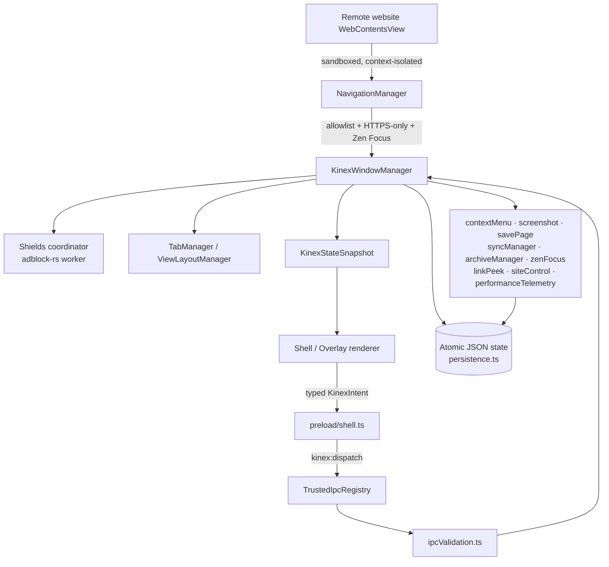

<div align="center">
  
  <h1>Kinex Browser (v0.7.23)</h1>
  <p>A fast, memory-efficient, everyday privacy-focused macOS desktop browser built on Chromium and Electron — with zero AI bloat.</p>
  <p>
    <a href="LICENSE"></a>
    
    
  </p>
</div>

---

## v0.7.23 verification

Electron is pinned to **45.3.3**, with Chromium **156.0.8078.100** and embedded Node **24.22.3**. Version numbering was reset from 7.0.3 to 0.7.3; the 0.x line is pre-production and 1.0.0 is reserved for the production release. The current local preview is unsigned and not notarized. Free 0.x Releases include an ad-hoc sealed DMG and ZIP for manual installation; they have no verified Developer ID and are not notarized. Automatic update installation requires matching Developer ID signing even before 1.0.0; no auto-update manifest is published for unsigned previews. It adds profile-scoped permission grants, stricter IPC and TLS boundaries, recoverable state writes, safer downloads, and worker-based cold Shields initialization. Existing unscoped permission grants require fresh consent.

Read the [release evidence and readiness report](docs/quality/v7.0.3-report.md), [compatibility matrix](docs/quality/compatibility-matrix.md), [security architecture](docs/security-architecture.md), and [test procedures](docs/quality/testing.md). Public landing pages do not establish authenticated app compatibility. The Figma public homepage now passes after fixing a loading-state defect where subframe loads were reported as tab loading. Intermittent probe CDP timeouts were a probe defect, not a browser one: a backgrounded tab produces no compositor frames, so paint waits and wheel input never completed and were misreported as website failures. Signed distribution and protected playback remain unverified. The report retains an intermittent combined-suite native focus failure.

Every completed main push receives a new patch version. Successful main CI triggers preview publication with DMG verification and mounted-app startup checks. Signing credentials are optional for 0.x manual previews and required for production and signed auto-installation. Contributor rules and handoff notes are in [AGENTS.md](AGENTS.md).

For older 0.7.x installations, see [update compatibility and signing prerequisites](docs/quality/update-compatibility.md).

## Features

- **Kinex Design System & UI (`v0.6.0`–`v0.7.0`)**: Semantic Light/Dark design tokens (`tokens.css`) synchronized across sidebar vibrancy, New Tab canvases, Settings, Downloads, Command Bar, and Split View — plus full `prefers-reduced-motion`, `prefers-reduced-transparency`, and `:focus-visible` keyboard accessibility support.
- **Complete Tab, Space & Navigation Workflow**: Instant cross-Space Tab Search in Command Bar, Recently Closed Tabs & Group Restoration (`⌘⇧T`), Duplicate Tab Detection, profile-isolated Move to Space, Space-scoped Favorites & Folders, drag-and-drop Space reordering, Find in Page match counts (`⌘F`), per-site Zoom memory, Print & Save as PDF (`⌘P` / `⌘⇧P`), script-disabled **Reader Mode** (`⌥⌘R`), live Download Pause/Resume/Speed/ETA, and macOS Default Browser (`http`/`https`) integration.
- **Customizable New Tab Experience (`kinex://newtab`)**: Switch between **Minimal**, **Focus**, and **Personal** presets, adjust subtle backdrop atmospheres (`Clean`, `Mist`, `Dusk`, `Sage`), toggle Clock / Pinned Favorites / Frequently Visited modules in Settings, and keep Light/Dark Space harmony automatically.
- **Workspace Sidebar & Spaces**: Organize browsing into Spaces backed by isolated Chromium cookie/storage Profiles, custom themes over native macOS frosted glass (`under-window` vibrancy), and an inset web viewport. Each regular window owns one Space; `⌘N` opens a new window with its own Space, and restoring a cold start recreates every non-private window with its Space and Split View.
- **Extensions**: Install unpacked Manifest V3 extensions from a local folder, a signed CRX3 package, or a Chrome Web Store item URL into the active Space's Profile. Kinex verifies CRX3 signatures and package IDs, reviews permissions before enabling, and exposes action icons/popups in the toolbar and Sidebar. Extensions stay inside their Profile partition and are never loaded into private windows.
- **Favorites, Pinned Folders & Today Tabs**: Keep core apps in Favorites, organize Pinned tabs in collapsible Folders (closing resets back to the pinned URL), and archive ephemeral Today tabs with one click.
- **Command Bar (`⌘T` / `⌘L`)**: Instant search across open tabs, pinned items, history, traditional search engines (Google, DuckDuckGo, Bing, Startpage, Kagi), and browser actions.
- **Split View (`⌘⇧\`) & Little Kinex (`⌥⌘N`)**: View two tabs side-by-side with an adjustable ratio slider, or open quick links in a floating Little Kinex window and promote them into any Space.
- **Boosts Studio & Element Zapper (`⌘⇧B`)**: Apply per-domain custom CSS, JavaScript, fonts, Smart Dark Invert, or click any element on a page to hide it persistently.
- **Performance & Memory Saver**:
  - Lazy overlay renderer allocation and deferred startup checks for fast cold/warm launch
  - Configurable **Memory Saver** (`Disabled`, `5m`, `15m`, `30m` default, `60m`) with pinned/favorite exemption; never discards active, Split View, audible, downloading, media-capture, or unsaved-form tabs
  - Native background throttling, debounced async JSON persistence, coalesced IPC broadcasts, and native Rust request filtering
  - Measured startup, 1–50 tab scaling, Memory Saver, and 7-scenario leak stress results documented in [BENCHMARKS.md](BENCHMARKS.md)
- **Privacy & Security**:
  - Sandboxed `WebContentsView` webviews (`contextIsolation: true`, `nodeIntegration: false`, `sandbox: true`, `webSecurity: true`, `navigateOnDragDrop: false`)
  - Runtime IPC sender verification (`TrustedIpcRegistry`) and strict schema validation (`ipcValidation.ts`)
  - Explicit protocol allowlisting (`https:`, `http:`, `kinex:`, `nook:` -> `kinex://`, `about:blank`) and prompt-gated external handoff (`mailto:`, `tel:`)
  - **HTTPS-Only Mode** with network error classification (never silently downgrading on DNS, offline, timeout, or TLS certificate errors; insecure HTTP fallback requires explicit user confirmation)
  - **Isolated Private Windows (`⌘⇧N`)**: Ephemeral non-persistent Chromium partitions with strict sensitive permission denial, no history/download recording, disabled silent promotion into regular tabs, and session storage/cache purge on close
  - **Kinex Shields (`adblock-rs` + `tldts`)**: Native Rust content-blocking engine with 7 bundled offline filter lists (`EasyList`, `EasyPrivacy`, `uBlock Origin Filters/Privacy/Quick Fixes`, `Peter Lowe's`, and `Fanboy Cookie`), Standard/Aggressive/Disabled global and per-site precedence, dynamic isolated-world cosmetic filtering, Element Picker, HTTPS list updates, and **Clean Copy URL** (`⌘⇧C` / navigation param stripping) — documented in [SHIELDS_BENCHMARKS.md](SHIELDS_BENCHMARKS.md)
- **Migration & Import**: Backward-compatible state migration from legacy `NOOK/nook-state.json` and `nook://` URLs while preserving existing `persist:nook-*` profile cookies/sessions, plus Arc (`StorableSidebar.json`), Chrome (`Bookmarks`), and HTML bookmark import.
- **In-App Auto-Updater**: Built on `electron-updater` / `Squirrel.Mac`, validating update feeds (`https://`, localhost, or local release directory) against `latest-mac.yml`.
- **Encrypted Sync (`v0.7.20`)**: AES-256-GCM `.kinex-sync` export/import with scrypt key derivation, authenticated envelope, deny-by-default allowlist (Private windows, cookies, passwords and credentials never serialized), plus rotated folder/iCloud mirror backups.
- **Performance & Site Controls (`v0.7.20`)**: `kinex://performance` reports tabs, sleeping tabs, estimated reclaimed memory and Shields blocks; a toolbar site-control popover shows connection/Shields/cookie/permission state with scoped overrides.
- **Native Context Menu & Capture (`v0.7.20`)**: Hostile-payload-sanitized right-click menu, visible/area screenshots to PNG or clipboard, MHTML save, DevTools/Console/View Source and macOS swipe Back/Forward with a reduced-motion-aware edge indicator.
- **Focus & Reading Tools (`v0.7.20`)**: Shift-click Link Peek in a sandboxed `WebContentsView`, Reader appearance controls and a per-Space Reading List, configurable auto-archive with a searchable vault and nested folders, QR sharing, and Zen Focus Mode with per-Space distraction rules.
- **Preference Surface (`v0.7.20`)**: Searchable Settings with theme/sidebar-side/density/accent/vibrancy, full URL, default zoom, startup and custom search (`%s`, `@kw`), download folder, cookie/referrer/WebRTC policy, custom shortcuts with conflict detection, timed/per-Space data deletion, and a dismissible first-run welcome card.

---

## Architecture Overview

```text
src/
├── main/
│   ├── index.ts              # App lifecycle, custom schemes, runtime-validated IPC handlers
│   ├── windowManager.ts      # KinexWindowManager coordinator, intents, state broadcast & disposal
│   ├── ipcValidation.ts      # Trusted sender registry & exhaustive runtime intent validation
│   ├── navigationManager.ts  # Navigation/redirect guards, HTTPS-only prompt & cert error handling
│   ├── sessionManager.ts     # Profile partitions, kinex/nook protocols, isolated private sessions
│   ├── permissionManager.ts  # Profile-scoped per-origin permission checks, prompts & revocation
│   ├── downloadManager.ts    # Download tracking & tracked-path verification for Finder reveal
│   ├── memorySaver.ts        # Safe background tab discard policy & timeout definitions
│   ├── tabManager.ts         # WebContentsView lifecycle, throttling, discard/restore & recovery
│   ├── viewLayoutManager.ts  # Multi-view geometry & Split View bounds calculation
│   ├── auxiliaryWindows.ts   # Little Kinex & isolated Private Windows
│   ├── appMenu.ts            # Native macOS application menu & accelerators
│   ├── importController.ts   # Arc, Chrome & HTML bookmark import flows
│   ├── persistence.ts        # Atomic JSON state persistence & NOOK -> Kinex migration
│   ├── security.ts           # URL guards, Chromium error classification, tracker stripping
│   ├── shields/              # Kinex Shields: adblock-rs engine, lists, scriptlets, cosmetics, coordinator
│   ├── boosts.ts             # Per-domain CSS/JS injection & Boosts Zapper
│   ├── internalPages.ts      # kinex://welcome, kinex://private, kinex://crashed HTML templates
│   └── updater.ts            # KinexAutoUpdater (remote HTTPS & local feed server)
├── preload/
│   └── shell.ts              # Context-isolated window.kinexAPI bridge (shell/overlay/header only)
├── shared/
│   ├── types.ts              # Shared domain, IPC intent, snapshot & API contracts
│   ├── domain.ts             # Pure navigation normalization, tab/split transitions, Command Bar search
│   └── importer.ts           # Pure Arc, Chrome & HTML bookmark parsers
└── renderer/
    ├── App.tsx               # Shell, Overlay & Little Kinex / Private header router
    └── styles/
        ├── tokens.css        # Light/Dark, contrast, spacing & typography tokens
        └── kinex.css         # Frosted vibrancy shell, overlays & macOS styling
    └── components/           # Sidebar, TopControls, CommandBar, SettingsView, BoostPanel, SpaceEditor
```



---

## Keyboard Shortcuts

| Shortcut | Action |
| --- | --- |
| `⌘T` / `⌘L` | Command Bar / address bar (inline math and unit conversions) |
| `⌘⇧\` | Toggle Split View; the 50/50 button resets the ratio |
| `⌃⌘S` | Collapse or expand the Sidebar (bare `⌘S` remains native Save) |
| `⌥⌘S` | Show or hide the Sidebar |
| `⌥⌘I` / `⌥⌘J` / `⌥⌘U` | DevTools / Console / View Source |
| `⌘⇧S` | Screenshot the visible page |
| `⌥⌘R` / `⇧⌘D` | Reader Mode / Reading List |
| `⌥⌘F` | Zen Focus for the active Space |
| `⌘⇧A` | Archived Vault |
| `⇧⌘⌫` | Clear browsing data |
| `⌘Y` / `⌘J` | History / Downloads |

## Limitations

- **0.x preview**: ad-hoc sealed DMG/ZIP for manual installation; no Developer ID or notarization, so Gatekeeper may block first launch. Signed automatic installation requires Developer ID credentials.
- **Native Share sheet** is not wired; QR sharing renders a scannable code with a copy-link fallback.
- **WebAuthn/passkey** and protected playback (DRM/Widevine) need hardware/credential flows that are not verified by the automated suites.
- Custom filter URLs and site whitelist are persisted preference surfaces; applying them to the native Shields engine is incremental.
- Shortcuts shown with `⌘S` in older documentation are now `⌃⌘S` for Sidebar collapse; `⌘S` is reserved for native Save.

---

## Security Model

1. **Privilege Separation**: Only internal UI views (`?view=shell`, `?view=overlay`, `?view=little`, `?view=private`) load `preload/shell.ts`. Untrusted remote `WebContentsView` tabs run with `sandbox: true`, `contextIsolation: true`, `nodeIntegration: false`, and zero preload access to `window.kinexAPI`.
2. **IPC Defense-in-Depth**: Every `ipcMain.handle('kinex:*')` verifies both sender `webContents.id` role registration and main-frame identity and exact sender document URL before validating all fields with `validateIntent` / `validateTabContextMenuInput` / `validateLittleKinexActionInput`. Download Finder reveals are restricted to paths tracked by `DownloadManager`.
3. **Navigation & HTTPS Protections**: `will-navigate`, `will-redirect`, and `setWindowOpenHandler` block `javascript:`, `file:`, `data:`, `vbscript:`, and unapproved custom schemes across tabs, popups, Little Kinex, and Private Windows. Certificate errors and HTTPS-only upgrade failures require explicit user confirmation and never fail open or downgrade silently on DNS/timeout/offline errors.
4. **Private Session Isolation**: Private windows run on unique non-persistent `kinex-private-*` partitions (`{ cache: false }`), deny sensitive tracking/hardware permissions without persistence, omit history/download tracking, block `"Open in Kinex"` promotion, and purge storage, cache, and auth cache when closed.

---

## Development & Automated Testing

Use **Node.js 24**, npm, Rust/Cargo, and Xcode command-line tools on macOS 13 or newer. Apple Silicon is the locally validated target. See [build and signing](docs/quality/build-and-signing.md).

```bash
npm ci
npx --no-install install-electron
npm run typecheck          # Typecheck Electron main/preload + React renderer
npm test                   # Unit tests (domain, migration, IPC validation, security policies)
npm run test:integration   # Real Electron main-process, session isolation & Memory Saver tests
npm run test:windows       # Real Electron multi-window cold start, Space binding & IPC routing tests
npm run test:extensions    # Real Electron MV3 extension lifecycle, CRX3, content script, popup & isolation tests
npm run test:e2e           # Full 15-workflow CDP E2E suite against a local HTTP test server
npm run test:shields       # Kinex Shields network, cosmetic, scriptlet & privacy integration suite
npm run test:leak          # 7-scenario stress & memory leak test suite
npm run test:all           # Unit, native, browser, keyboard, security, and Shields startup checks
npm run lint               # Compiler checks for unused locals and parameters
npm run bench              # Run reproducible startup + 1/5/10/25/50-tab benchmarks
npm run bench:memory-saver # Measure 25/50-tab RSS savings with Memory Saver enabled
npm start                  # Build and launch Kinex locally
```

---

## Packaging and release verification

```bash
npm run package:mac        # Builds an ad-hoc sealed arm64 preview app, DMG and ZIP
```

1. Ensure `npm run test:all` passes cleanly with zero skipped tests.
2. Keep package and lockfile versions consistent with `npm version <version> --no-git-tag-version`.
3. Run `npm run package:mac`, then `node tests/integration/run-dmg.mjs`. The checks verify the bundle signature, hardened runtime, and mounted app startup. Generated auto-update metadata is not published for ad-hoc previews.
4. `package:mac` explicitly builds an ad-hoc preview with a dedicated entitlement profile. The signed release workflow uses the strict production profile and requires Developer ID/notarization credentials. Read [build and signing](docs/quality/build-and-signing.md) for the distinction; integrity verification does not establish Gatekeeper trust.

---

## Feature Verification Status & Limitations

- **Verified by automated unit, integration, and Electron E2E tests**: Workspace/Space creation & switching, Space-scoped cookie/storage profile isolation, tab navigation/back/forward/reload, Split View toggling & layout geometry, Command Bar, Private Window session & permission isolation, tab close & Archive restore, restart persistence, `nook://`/`nook-state.json` migration, IPC validation & sender enforcement, navigation scheme blocking, HTTPS error classification, and view/timer disposal.
- **Partially verified / manual**: Live interactive `dialog.showMessageBox` flows (certificate bypass confirmation, explicit HTTP fallback prompt, OS-level permission prompt), physical camera/microphone capture, and remote GitHub Releases `autoUpdater` upgrade against a signed DMG/ZIP feed (local `latest-mac.yml` generation & feed classification are verified).
- **Blocked release gates**: Developer ID signing, notarization, signed update installation, authenticated provider workflows, and hardware media consent. CI configuration is prepared; these outcomes are not established locally. Automated multi-window restoration and Linux/Windows builds remain outside this release.

## License

Kinex is licensed under the **GNU General Public License v3.0 (GPL-3.0-only)**. See [LICENSE](LICENSE) for the full text.
