<div align="center">
  
  <h1>Kinex Browser (v7.0.2)</h1>
  <p>A fast, memory-efficient, everyday privacy-focused macOS desktop browser built on Chromium and Electron — with zero AI bloat.</p>
  <p>
    <a href="LICENSE"></a>
    
    
  </p>
</div>

---

## Features

- **Kinex Design System & UI (`v0.6.0`–`v0.7.0`)**: Semantic Light/Dark design tokens (`tokens.css`) synchronized across sidebar vibrancy, New Tab canvases, Settings, Downloads, Command Bar, and Split View — plus full `prefers-reduced-motion`, `prefers-reduced-transparency`, and `:focus-visible` keyboard accessibility support.
- **Complete Tab, Space & Navigation Workflow**: Instant cross-Space Tab Search in Command Bar, Recently Closed Tabs & Group Restoration (`⌘⇧T`), Duplicate Tab Detection, profile-isolated Move to Space, Space-scoped Favorites & Folders, drag-and-drop Space reordering, Find in Page match counts (`⌘F`), per-site Zoom memory, Print & Save as PDF (`⌘P` / `⌘⇧P`), script-disabled **Reader Mode** (`⌥⌘R`), live Download Pause/Resume/Speed/ETA, and macOS Default Browser (`http`/`https`) integration.
- **Customizable New Tab Experience (`kinex://newtab`)**: Switch between **Minimal**, **Focus**, and **Personal** presets, adjust subtle backdrop atmospheres (`Clean`, `Mist`, `Dusk`, `Sage`), toggle Clock / Pinned Favorites / Frequently Visited modules in Settings, and keep Light/Dark Space harmony automatically.
- **Workspace Sidebar & Spaces**: Organize browsing into Spaces backed by isolated Chromium cookie/storage Profiles, custom themes over native macOS frosted glass (`under-window` vibrancy), and an inset web viewport.
- **Favorites, Pinned Folders & Today Tabs**: Keep core apps in Favorites, organize Pinned tabs in collapsible Folders (closing resets back to the pinned URL), and archive ephemeral Today tabs with one click.
- **Command Bar (`⌘T` / `⌘L`)**: Instant search across open tabs, pinned items, history, traditional search engines (Google, DuckDuckGo, Bing, Startpage, Kagi), and browser actions.
- **Split View (`⌘⇧\`) & Little Kinex (`⌥⌘N`)**: View two tabs side-by-side with an adjustable ratio slider, or open quick links in a floating Little Kinex window and promote them into any Space.
- **Boosts Studio & Element Zapper (`⌘⇧B`)**: Apply per-domain custom CSS, JavaScript, fonts, Smart Dark Invert, or click any element on a page to hide it persistently.
- **Performance & Memory Saver**:
  - Lazy overlay renderer allocation and deferred startup checks for fast cold/warm launch
  - Configurable **Memory Saver** (`Disabled`, `5m`, `15m`, `30m` default, `60m`) with pinned/favorite exemption; never discards active, Split View, audible, downloading, media-capture, or unsaved-form tabs
  - Native background throttling, debounced async JSON persistence, coalesced IPC broadcasts, and `Set`-backed domain tracker filtering
  - Measured startup, 1–50 tab scaling, Memory Saver, and 7-scenario leak stress results documented in [BENCHMARKS.md](BENCHMARKS.md)
- **Privacy & Security**:
  - Sandboxed `WebContentsView` webviews (`contextIsolation: true`, `nodeIntegration: false`, `sandbox: true`, `webSecurity: true`, `navigateOnDragDrop: false`)
  - Runtime IPC sender verification (`TrustedIpcRegistry`) and strict schema validation (`ipcValidation.ts`)
  - Explicit protocol allowlisting (`https:`, `http:`, `kinex:`, `nook:` -> `kinex://`, `about:blank`) and prompt-gated external handoff (`mailto:`, `tel:`)
  - **HTTPS-Only Mode** with network error classification (never silently downgrading on DNS, offline, timeout, or TLS certificate errors; insecure HTTP fallback requires explicit user confirmation)
  - **Isolated Private Windows (`⌘⇧N`)**: Ephemeral non-persistent Chromium partitions with strict sensitive permission denial, no history/download recording, disabled silent promotion into regular tabs, and session storage/cache purge on close
  - **Kinex Shields (`adblock-rs` + `tldts`)**: Native Rust content-blocking engine with 7 bundled offline filter lists (`EasyList`, `EasyPrivacy`, `uBlock Origin Filters/Privacy/Quick Fixes`, `Peter Lowe's`, and `Fanboy Cookie`), Standard/Aggressive/Disabled global and per-site precedence, dynamic isolated-world cosmetic filtering, Element Picker, HTTPS list updates, and **Clean Copy URL** (`⌘⇧C` / navigation param stripping) — documented in [SHIELDS_BENCHMARKS.md](SHIELDS_BENCHMARKS.md)
- **Migration & Import**: Backward-compatible state migration from legacy `NOOK/nook-state.json` and `nook://` URLs while preserving existing `persist:nook-*` profile cookies/sessions, plus Arc (`StorableSidebar.json`), Chrome (`Bookmarks`), and HTML bookmark import.
- **In-App Auto-Updater**: Built on `electron-updater` / `Squirrel.Mac`, validating update feeds (`https://`, localhost, or local release directory) against `latest-mac.yml`.

---

## Architecture Overview

```text
src/
├── main/
│   ├── index.ts              # App lifecycle, custom schemes, runtime-validated IPC handlers
│   ├── windowManager.ts      # KinexWindowManager coordinator, intents, state broadcast & disposal
│   ├── ipcValidation.ts      # Trusted sender registry & exhaustive runtime intent validation
│   ├── navigationManager.ts  # Navigation/redirect guards, HTTPS-only prompt & cert error handling
│   ├── sessionManager.ts     # Profile partitions, kinex/nook protocols, isolated private sessions
│   ├── permissionManager.ts  # Consistent per-origin permission checks, prompts & revocation
│   ├── downloadManager.ts    # Download tracking & tracked-path verification for Finder reveal
│   ├── memorySaver.ts        # Safe background tab discard policy & timeout definitions
│   ├── tabManager.ts         # WebContentsView lifecycle, throttling, discard/restore & recovery
│   ├── viewLayoutManager.ts  # Multi-view geometry & Split View bounds calculation
│   ├── auxiliaryWindows.ts   # Little Kinex & isolated Private Windows
│   ├── appMenu.ts            # Native macOS application menu & accelerators
│   ├── importController.ts   # Arc, Chrome & HTML bookmark import flows
│   ├── persistence.ts        # Atomic JSON state persistence & NOOK -> Kinex migration
│   ├── security.ts           # URL guards, Chromium error classification, tracker stripping
│   ├── shields/              # Kinex Shields: adblock-rs engine, lists, scriptlets, cosmetics, coordinator
│   ├── boosts.ts             # Per-domain CSS/JS injection & Boosts Zapper
│   ├── internalPages.ts      # kinex://welcome, kinex://private, kinex://crashed HTML templates
│   └── updater.ts            # KinexAutoUpdater (remote HTTPS & local feed server)
├── preload/
│   └── shell.ts              # Context-isolated window.kinexAPI bridge (shell/overlay/header only)
├── shared/
│   ├── types.ts              # Shared domain, IPC intent, snapshot & API contracts
│   ├── domain.ts             # Pure navigation normalization, tab/split transitions, Command Bar search
│   └── importer.ts           # Pure Arc, Chrome & HTML bookmark parsers
└── renderer/
    ├── App.tsx               # Shell, Overlay & Little Kinex / Private header router
    └── styles/
        ├── tokens.css        # Light/Dark, contrast, spacing & typography tokens
        └── kinex.css         # Frosted vibrancy shell, overlays & macOS styling
    └── components/           # Sidebar, TopControls, CommandBar, SettingsView, BoostPanel, SpaceEditor
```

---

## Security Model

1. **Privilege Separation**: Only internal UI views (`?view=shell`, `?view=overlay`, `?view=little`, `?view=private`) load `preload/shell.ts`. Untrusted remote `WebContentsView` tabs run with `sandbox: true`, `contextIsolation: true`, `nodeIntegration: false`, and zero preload access to `window.kinexAPI`.
2. **IPC Defense-in-Depth**: Every `ipcMain.handle('kinex:*')` verifies both sender `webContents.id` role registration and sender frame base URL before validating all fields with `validateIntent` / `validateTabContextMenuInput` / `validateLittleKinexActionInput`. Download Finder reveals are restricted to paths tracked by `DownloadManager`.
3. **Navigation & HTTPS Protections**: `will-navigate`, `will-redirect`, and `setWindowOpenHandler` block `javascript:`, `file:`, `data:`, `vbscript:`, and unapproved custom schemes across tabs, popups, Little Kinex, and Private Windows. Certificate errors and HTTPS-only upgrade failures require explicit user confirmation and never fail open or downgrade silently on DNS/timeout/offline errors.
4. **Private Session Isolation**: Private windows run on unique non-persistent `kinex-private-*` partitions (`{ cache: false }`), deny sensitive tracking/hardware permissions without persistence, omit history/download tracking, block `"Open in Kinex"` promotion, and purge storage, cache, and auth cache when closed.

---

## Development & Automated Testing

Requires **Node.js >= 22** and **npm** on macOS.

```bash
npm install
npm run typecheck          # Typecheck Electron main/preload + React renderer
npm test                   # Unit tests (domain, migration, IPC validation, security policies)
npm run test:integration   # Real Electron main-process, session isolation & Memory Saver tests
npm run test:e2e           # Full 15-workflow CDP E2E suite against a local HTTP test server
npm run test:shields       # Kinex Shields network, cosmetic, scriptlet & privacy integration suite
npm run test:leak          # 7-scenario stress & memory leak test suite
npm run test:all           # Run typecheck + unit + integration + E2E + keyboard + experience + shields
npm run bench              # Run reproducible startup + 1/5/10/25/50-tab benchmarks
npm run bench:memory-saver # Measure 25/50-tab RSS savings with Memory Saver enabled
npm start                  # Build and launch Kinex locally
```

---

## Packaging & Release Checklist (`v0.5.0`)

```bash
npm run package:mac        # Builds dist/, dist-electron/, Kinex.app, arm64 zip, latest-mac.yml
```

1. Ensure `npm run test:all` passes cleanly with zero skipped tests.
2. Bump version cleanly in `package.json` (or use `npm run release:local`).
3. Run `npm run package:mac` and inspect `release/latest-mac.yml` + `release/mac-arm64/Kinex.app`.
4. Note on macOS signing & notarization: Local `electron-builder` builds are unsigned/ad-hoc signed unless Apple Developer ID certificates (`CSC_LINK`, `CSC_KEY_PASSWORD`) and notarization credentials are configured in CI/release environment.

---

## Feature Verification Status & Limitations

- **Verified by automated unit, integration, and Electron E2E tests**: Workspace/Space creation & switching, Space-scoped cookie/storage profile isolation, tab navigation/back/forward/reload, Split View toggling & layout geometry, Command Bar, Private Window session & permission isolation, tab close & Archive restore, restart persistence, `nook://`/`nook-state.json` migration, IPC validation & sender enforcement, navigation scheme blocking, HTTPS error classification, and view/timer disposal.
- **Partially verified / manual**: Live interactive `dialog.showMessageBox` flows (certificate bypass confirmation, explicit HTTP fallback prompt, OS-level permission prompt), physical camera/microphone capture, and remote GitHub Releases `autoUpdater` upgrade against a signed DMG/ZIP feed (local `latest-mac.yml` generation & feed classification are verified).
- **Planned for future releases**: Apple Developer ID code-signing + notarization in CI, automated multi-window session restoration UI, and cross-platform Linux/Windows builds.

## License

Kinex is licensed under the **GNU General Public License v3.0 (GPL-3.0-only)**. See [LICENSE](LICENSE) for the full text.
